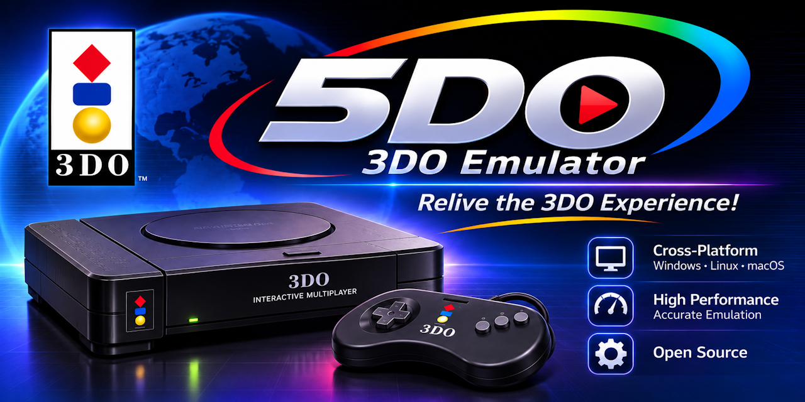

<p align="center">
  <a href="https://github.com/purelogiccode/5DO/actions/workflows/ci.yml"></a>
  <a href="https://github.com/purelogiccode/5DO/actions/workflows/docs.yml"></a>
  <a href="https://github.com/purelogiccode/5DO/actions/workflows/codeql.yml"></a>
  <a href="https://securityscorecards.dev/viewer/?uri=github.com/purelogiccode/5DO"></a>
  <a href="https://purelogiccode.github.io/5DO/"></a>
  <a href="https://github.com/purelogiccode/5DO/wiki"></a>
</p>

<p align="center">
  
  
  
  <a href="LICENSE"></a>
  <a href="CHANGELOG.md"></a>
</p>

<p align="center">
  
</p>

<h1 align="center">5DO</h1>

<p align="center">
  A modern, source-available <strong>C# / .NET 10</strong> emulator for the
  <strong>3DO Interactive Multiplayer</strong>.
</p>

> [!IMPORTANT]
> 5DO is at **v1.5.0**, a documented-compatibility release. Windows x64 is the validated
> target; Linux x64 full suite passed (GPU presentation is preview/best-effort), and
> macOS/arm64 validation is post-1.0. No BIOS ROMs, game images, or extracted game
> assets are included. You must supply legally obtained files.

**5DO** is an accuracy-focused C# port of the FreeDO 3DO emulation core, with
[Opera/libopera](https://github.com/libretro/opera-libretro) as the primary behavioral
reference for new compatibility work. It combines a deterministic managed emulation
core with a cross-platform **Avalonia** desktop frontend, a headless **CLI**, and a
test harness designed for reproducible compatibility evidence.

## Why 5DO?

- **Managed from top to bottom.** The ARM60 CPU, CLIO, MADAM/CEL, DSP, SPORT, VDLP,
  XBUS, CD-ROM, storage, audio, and input paths are pure C#. No native emulator DLL,
  no C++/CLI, and no P/Invoke into FreeDOCore.
- **Built for determinism.** Fixed timesteps, explicit state serialization, seeded
  options, and per-frame PBUS recording make frames, audio, save states, and TAS
  movies reproducible.
- **A real desktop emulator.** Avalonia shell with a game library, cover art, BIOS and
  NVRAM managers, save slots with thumbnails, rewind/fast-forward, cheats, TAS
  recording, screenshots, GIF/WAV capture, a disc browser, controller mapping, and a
  diagnostics bundle.
- **Modern presentation.** Two-stage OpenGL/GLES presenter with accurate, nearest,
  sharp-bilinear, CRT, xBR-lv2, FSR 1.0, and GPU rule-table HQx 2x/3x/4x filters, plus
  480i/240p field handling (auto detection, bob, weave, and blend). Optional Vulkan 1.0
  and Direct3D 11 backends mirror the pipeline for desktop and headless probes.
- **Powerful automation.** Headless `run`, `trace`, `bench`, `selftest`, disc/BIOS/
  NVRAM/cheat/movie/state commands, JSON output, watchpoints, dumps, and differential
  harnesses. Startup and `5do update` check the public GitHub release feed.
- **One bundle per system and architecture.** Windows, Linux, and macOS bundles for x64
  and arm64 contain both the framework-dependent single-file CLI and desktop app, plus
  the docs/notices. The .NET 10 runtime is a prerequisite and is **not** bundled.
  Optional NativeAOT CLI builds remain available for developers.

## Status at a glance

| Area | Current state |
|---|---|
| Version | `1.5.0` release (GitHub Releases) |
| Validated platform | **Windows x64** |
| Build/publish targets | Windows, Linux, macOS — x64 and arm64 |
| Automated tests | **2,033 tests** in the current test assembly |
| Differential oracle | 50-title panel: **50/50 frame hashes** at frames 60/120/300; only CD cadence remains |
| Library | **653 games** across **1,366 images**; 3 audio-only CHDs catalogued |
| Loadability sweep | **594 disc images** tested; after triage **593 loadable/rendered**, 1 known no-video case, 0 not loadable |
| First pass | 576 rendered, 13 black/blank, 5 not loadable; triage resolved the failures and the blank/black set |
| Desktop presentation | OpenGL/GLES required; Vulkan and Direct3D 11 optional; CPU fallback available |
| Audio | Exact 44.1 kHz DSP clock; bundled OpenAL Soft 1.23.1 |

The full compatibility picture, per-title evidence, and remaining limitations live in
the [compatibility documentation](https://purelogiccode.github.io/5DO/Compatibility.html),
[game compatibility list](https://purelogiccode.github.io/5DO/GameCompatibilityList.html),
and [known issues](https://purelogiccode.github.io/5DO/KnownIssues.html).

## Download

One bundle per system and architecture, each containing both the desktop app and the CLI:

| System | Bundle |
|---|---|
| Windows x64 | [`5do-1.5.0-win-x64.zip`](https://github.com/purelogiccode/5DO/releases/download/v1.5.0/5do-1.5.0-win-x64.zip) |
| Windows arm64 | [`5do-1.5.0-win-arm64.zip`](https://github.com/purelogiccode/5DO/releases/download/v1.5.0/5do-1.5.0-win-arm64.zip) |
| Linux x64 | [`5do-1.5.0-linux-x64.tar.gz`](https://github.com/purelogiccode/5DO/releases/download/v1.5.0/5do-1.5.0-linux-x64.tar.gz) |
| Linux arm64 | [`5do-1.5.0-linux-arm64.tar.gz`](https://github.com/purelogiccode/5DO/releases/download/v1.5.0/5do-1.5.0-linux-arm64.tar.gz) |
| macOS x64 | [`5do-1.5.0-osx-x64.tar.gz`](https://github.com/purelogiccode/5DO/releases/download/v1.5.0/5do-1.5.0-osx-x64.tar.gz) |
| macOS arm64 | [`5do-1.5.0-osx-arm64.tar.gz`](https://github.com/purelogiccode/5DO/releases/download/v1.5.0/5do-1.5.0-osx-arm64.tar.gz) |

The apps are single-file executables. **Install the .NET 10 Runtime first** from
<https://dotnet.microsoft.com/download/dotnet/10.0>; the bundles do **not** contain a
.NET runtime. See the [release page](https://github.com/purelogiccode/5DO/releases/tag/v1.5.0)
for `SHA256SUMS.txt` and [what's new](https://purelogiccode.github.io/5DO/WhatsNew.html).

Bundles are versioned and published for x64 and arm64, for example `5do-1.5.0-win-arm64.zip`.

## Features

### Emulation core

- ARM60 interpreter with deterministic timing, banked registers, and a disassembler.
- Exact NTSC 60000/1001 (59.94 Hz) field clock and rational VDL accumulator, so audio and
  scanline timing do not drift against the reference core.
- Configurable 2-15 MB DRAM / 1-2 MB VRAM (stock 2 MB/1 MB), 2 MB ROM, NVRAM, high-resolution VRAM planes, and word-swapped storage.
- Opt-in unsigned-disc support patches the BIOS media RSA check in memory only; the BIOS
  file is never modified, and known No-RSA images are preferred when available.
- CLIO timers, interrupts, FIFOs, DMA, XBUS, and diagnostic port.
- MADAM CEL engine, matrix engine, pixel bus, CCB parsing, and pixel decoding.
- 3DO DSP with exact 44.1 kHz output, CD-DA mixing, and WAV analysis.
- SPORT VRAM fill/copy, VDLP display-list parsing, and CPU frame assembly.
- Mitsumi/MEI CD-ROM state machine with TOC, Sub-Q, CD-DA, multi-track CUE/CHD,
  M3U playlists, and ODE-style disc swapping.
- ISO, BIN, CUE+BIN, and CHD images, including parent/child CHDs and bounded
  read-ahead prefetch.

### Desktop experience

- Avalonia game library with local and online covers, favorites, play time, metadata
  filters, and sorts. The online catalog uses precomputed 4DO game IDs plus annotation-
  stripped Jaro-Winkler fallback and an optional bulk pack for offline use.
- BIOS manager with region/Kanji/Anvil/patch detection, auto-selection, and per-game
  overrides.
- Shared and per-game NVRAM with backup, import, reset, and delete.
- Ten save slots with PNG thumbnails, state inspection, state diffing, and format v3.
- Compressed rewind history (30–300 seconds) and 2×–10× fast-forward.
- Latency controls: 0-2 frame run-ahead, 0-8 frame presentation delay, VRR/adaptive-sync
  presentation, a -250..250 ms audio sync offset, and software input-to-present telemetry.
- Per-game cheats with raw/typed/conditional/button codes and a desktop manager.
- Deterministic `.5domovie` TAS recording, replay, verification, branching, and a
  per-frame movie editor.
- Disc browser with file/directory extraction, disc info, track listing, and integrity
  verification.
- Screenshots, screenshot gallery, GIF recording, WAV recording, and a live FPS/input
  overlay.
- Six-player keyboard and gamepad mapping; XInput on Windows and evdev on Linux;
  joypad, flightstick, mouse, lightgun, arcade lightgun, and Orbatak trackball devices.
- Portable mode, named configuration profiles, per-game profiles, and an instance lock.
- Privacy-scrubbed diagnostics bundles and an in-app log viewer.

### Presentation

- OpenGL 3.3 desktop and OpenGL ES 3.0/3.1 paths, including ANGLE on Windows.
- Accurate pixel-for-pixel mode matching the CPU frame assembler.
- Nearest, sharp-bilinear, CRT (scanlines, aperture mask, curvature, vignette, bloom),
  xBR-lv2 4x, FSR 1.0 (EASU + RCAS), and HQx 2x/3x/4x.
- Integer scaling, custom aspect ratios, fullscreen, vsync, and 4K output.
- Optional Vulkan 1.0 backend with build-time SPIR-V shaders and a native Win32
  swapchain path.

## Platform support

| Platform | Desktop | CLI | Status |
|---|:---:|:---:|---|
| Windows x64 | ✅ | ✅ | **Validated target** |
| Windows arm64 | ✅ | ✅ | Published; runtime validation pending |
| Linux x64 | ✅ | ✅ | Published; local VM smoke validation |
| Linux arm64 | ✅ | ✅ | Published; runtime validation pending |
| macOS x64 / arm64 | ✅ | ✅ | Published; runtime validation pending |
| Raspberry Pi 4/5 (GLES 3.1) | — | — | Post-1.0 target |

## Quick start

### Requirements

- **.NET SDK 10.0.301** (pinned by `global.json`).
- A legally obtained 3DO BIOS ROM (1 MB; an optional second ROM for BIOS2/Kanji).
- Legally obtained 3DO disc images in ISO, BIN, CUE+BIN, or CHD format.
- For the desktop app: Windows 10+, a current Linux desktop, or macOS 12+.
- OpenGL 3.3 or OpenGL ES 3.0/3.1 for GPU presentation; the CPU fallback needs no GPU.
- No system OpenAL installation is required; the build bundles OpenAL Soft 1.23.1.

> [!NOTE]
> v1.5.0 is published on GitHub Releases as one bundle per system and architecture (Windows, Linux,
> macOS; x64 and arm64), each with the CLI, desktop app, and SHA-256 checksums. The .NET 10
> runtime is required on the host and is not bundled. Build from source below if you
> prefer.
> BIOS and game files are never distributed by this repository.

### Build and test

```powershell
git clone https://github.com/purelogiccode/5DO.git
cd 5DO
dotnet build 5DO.sln
dotnet test 5DO.sln
```

### Run the desktop app

```powershell
dotnet run -c Release --project src/FiveDo.Frontend.Avalonia

# Open a disc directly (also used by file associations)
dotnet run -c Release --project src/FiveDo.Frontend.Avalonia -- "game.chd"

# Override the BIOS and start fullscreen
dotnet run -c Release --project src/FiveDo.Frontend.Avalonia -- `
  "game.chd" --bios "bios/panafz1.bin" --fullscreen
```

On first run, choose **Open BIOS**, select a BIOS such as `panafz1.bin`, choose
**Open Disc**, and press **Play**. See the [installation guide](https://purelogiccode.github.io/5DO/Installation.html)
for platform notes and data locations.

### Run headless

```powershell
# Render 600 frames and write a PNG
dotnet run --project src/FiveDo.Cli -- run game.chd --bios panafz1.bin `
  --frames 600 --frame-out frame.png

# Capture 10 seconds of 44.1 kHz audio
dotnet run --project src/FiveDo.Cli -- run game.chd --bios panafz1.bin `
  --frames 600 --audio wav --wav-out capture.wav

# Inspect a disc and verify every sector
dotnet run --project src/FiveDo.Cli -- info game.chd --json
dotnet run --project src/FiveDo.Cli -- disc verify game.chd --json

# Run the deterministic benchmark and self-test
dotnet run --project src/FiveDo.Cli -- bench --frames 600
dotnet run --project src/FiveDo.Cli -- selftest
```

The complete command surface is documented in the [CLI reference](https://purelogiccode.github.io/5DO/CliReference.html).

## Default controls

| 3DO button | Player 1 keyboard |
|---|---|
| D-pad | Arrow keys |
| A | `Z` |
| B | `X` |
| C | `C` |
| L | `A` |
| R | `S` |
| P (play/pause) | `Enter` |
| X (stop) | `Backspace` |

Useful desktop shortcuts: `F5` save state, `F8` load state, `F6`/`F7` change slots,
`F9` advance one frame while paused, `Shift+F9` rewind one frame, `R` rewind one
second, hold `Tab` to fast-forward, `F10` reset, `F11` fullscreen, `F12` screenshot,
`F3` swap disc, and `F4` open the quick menu. Bindings are configurable for eight
players in **Input**.

## Documentation

| Start here | What it covers |
|---|---|
| [Documentation site](https://purelogiccode.github.io/5DO/) | Complete user, reference, developer, and maintainer documentation |
| [User guide](https://purelogiccode.github.io/5DO/UserGuide.html) | Install, controls, settings, saves, library, recording, cheats, and CLI overview |
| [Installation](https://purelogiccode.github.io/5DO/Installation.html) | Platform setup, BIOS/disc placement, data folders, portable mode |
| [FAQ](https://purelogiccode.github.io/5DO/FAQ.html) | BIOS, discs, releases, performance, platforms, saves, and licensing |
| [CLI reference](https://purelogiccode.github.io/5DO/CliReference.html) | Every command, option, exit code, and JSON response |
| [Configuration](https://purelogiccode.github.io/5DO/Configuration.html) | `settings.json`, profiles, paths, input, NVRAM, environment variables |
| [Cover art](https://purelogiccode.github.io/5DO/CoverArt.html) | Online catalog, WebP pack, matching, R2 hosting, and takedown |
| [Compatibility](https://purelogiccode.github.io/5DO/Compatibility.html) | BIOS/disc compatibility, per-title status, and sweep evidence |
| [Troubleshooting](https://purelogiccode.github.io/5DO/Troubleshooting.html) | Symptom-driven diagnosis and fixes |
| [Developer guide](https://purelogiccode.github.io/5DO/DeveloperGuide.html) | Source map, invariants, extension points, and conventions |
| [Wiki](https://github.com/purelogiccode/5DO/wiki) | Concise community guides and links into the full documentation |

The documentation source lives in [`docs/`](docs/), and the site is built with
MkDocs Material. See [`docs/Documentation.md`](docs/Documentation.md) if you want to
build it locally or publish the wiki.

## Compatibility snapshot

The first full-collection loadability sweep covered **594 disc images**:

- **576** loaded and rendered on the first pass.
- **13** loaded but produced a black/blank first frame.
- **5** were not loadable on the first pass.

After triage, **593 are loadable/rendered** with **one known no-video case**
(`Crash 'n Burn` Japan), and **zero not-loadable rows** remain. The four Arcade CD-ROM
titles require `panafz10`-class BIOS behavior; the remaining blank/black titles render
by 6,000–9,000 frames or with the correct BIOS/region.

The 12 boot-validated titles, per-disc evidence, and honest per-title limitations are
in the [compatibility documentation](https://purelogiccode.github.io/5DO/Compatibility.html)
and [results table](https://purelogiccode.github.io/5DO/GameCompatibilityResults.html).
Full compatibility with the entire 3DO library is **not** claimed.

## Performance

The core is designed for 60 fps at 4K output with presentation-only scaling:

- Native 320×240 emulation; 4K is **output upscaling**, not internal CEL resolution.
- Road Rash's 3D race measures **4.20 ms/frame total (p99 7.40 ms)** on the reference
  machine after the 2026-10-31 performance pass, with an unchanged frame hash.
- 4K sharp-bilinear measures **GPU p99 0.089 ms** and **present p99 0.208 ms** on an
  RTX 4070 through the OpenGL path, with zero renderer/mailbox allocations per frame
  after warm-up.
- The synthetic benchmark gate enforces zero managed bytes/frame, core p99 ≤ 8 ms,
  total mean ≤ 8 ms, and total p99 ≤ 16.667 ms in CI.
- Presentation-only frame skipping (`Off`, `Auto`, `OneInTwo`–`OneInFive`) is
  available; `Auto` is the default.

See [Performance](https://purelogiccode.github.io/5DO/Performance.html) and
[Vulkan](https://purelogiccode.github.io/5DO/Vulkan.html) for the full measurements.

## Architecture

5DO keeps one console subsystem per assembly and a strict downward dependency rule:

```text
Frontends        FiveDo.Frontend.Avalonia        FiveDo.Cli
                        │                            │
Host             FiveDo.Host (settings, library, save slots, profiles, diagnostics)
                        │
Machine          FiveDo.Machine (composition, Quartz scheduler, frame loop)
                        │
Chips            CPU · Memory · MADAM · CLIO · DSP · SPORT · VDLP · XBUS · CD-ROM
                        │
Contracts        FiveDo.Core (interfaces, value types, state contracts, constants)
```

The core is platform-neutral and deterministic. The host owns files, devices, windows,
and settings. The Avalonia frontend and CLI are replaceable consumers of the same host
layer. See [Architecture](https://purelogiccode.github.io/5DO/Architecture.html) and
[Developer Guide](https://purelogiccode.github.io/5DO/DeveloperGuide.html).

## Build, test, and publish

```powershell
# Full solution
dotnet build 5DO.sln -c Release
dotnet test 5DO.sln -c Release

# Formatting
dotnet format 5DO.sln --verify-no-changes

# Trimmed, self-contained CLI for a target runtime
dotnet publish src/FiveDo.Cli/FiveDo.Cli.csproj -c Release -r win-x64 `
  --self-contained true -p:PublishSingleFile=true -p:PublishTrimmed=true

# Trimmed desktop frontend
dotnet publish src/FiveDo.Frontend.Avalonia/FiveDo.Frontend.Avalonia.csproj `
  -c Release -r win-x64 --self-contained true `
  -p:PublishSingleFile=true -p:PublishTrimmed=true

# Optional NativeAOT CLI
dotnet publish src/FiveDo.Cli/FiveDo.Cli.csproj -c Release -r win-x64 `
  --self-contained true -p:FiveDoNativeAot=true -p:PublishSingleFile=true
```

CI runs build/test on Windows, Linux, and macOS, format checks, benchmark budget gates,
NativeAOT smoke tests, unified bundle builds, and the release/wiki/docs deployment.
See [Build and Test](https://purelogiccode.github.io/5DO/BuildAndTest.html)
and [`packaging/README.md`](packaging/README.md).

## Contributing

Contributions are welcome. Start with [`CONTRIBUTING.md`](CONTRIBUTING.md), then read
the [Developer Guide](https://purelogiccode.github.io/5DO/DeveloperGuide.html),
[Test Strategy](https://purelogiccode.github.io/5DO/TestStrategy.html), and
[Build and Test](https://purelogiccode.github.io/5DO/BuildAndTest.html).

- Use [GitHub Discussions](https://github.com/purelogiccode/5DO/discussions) for
  questions and ideas, and [SUPPORT.md](SUPPORT.md) for the support map.
- Use the issue forms for reproducible bugs, feature requests, and compatibility
  reports.
- Follow the [Code of Conduct](CODE_OF_CONDUCT.md).
- Report security vulnerabilities privately through the
  [security policy](SECURITY.md); do not open a public issue.
- Do not include BIOS ROMs, game images, or extracted copyrighted assets in issues,
  pull requests, or test fixtures.

## Legal and attribution

5DO is **donationware**: non-commercial, source-available software funded by voluntary
donations rather than sales. It is distributed under the **FreeDO modified GNU LGPL**;
the FreeDO additional terms take precedence where they conflict with the LGPL. See
[`LICENSE`](LICENSE), [`THIRD-PARTY-NOTICES.md`](THIRD-PARTY-NOTICES.md), and
[`docs/Licensing.md`](docs/Licensing.md).

FreeDO, 4DO, and Opera/libopera are upstream projects with their own copyright notices
and terms. This repository does not include BIOS ROMs, game images, or extracted game
assets. Donations do not grant commercial rights.

"3DO" and "Panasonic" are trademarks of their respective owners. 5DO is not affiliated
with or endorsed by Panasonic, The 3DO Company, or any rights holder.

## Acknowledgements

- **FreeDO** and **4DO** for the original emulation core and game database.
- **Opera/libopera** for the behavioral reference used by modern compatibility work.
- **Avalonia**, **Silk.NET**, **CHDSharp**, **Serilog**, and **OpenAL Soft** for the
  platform, presentation, storage, diagnostics, and audio foundations.
- Every contributor who has recorded a frame hash, a save-state roundtrip, or a
  compatibility result.

---

<p align="center">
  <sub>Made with C# and .NET 10. Bring your own BIOS and discs.</sub>
</p>
