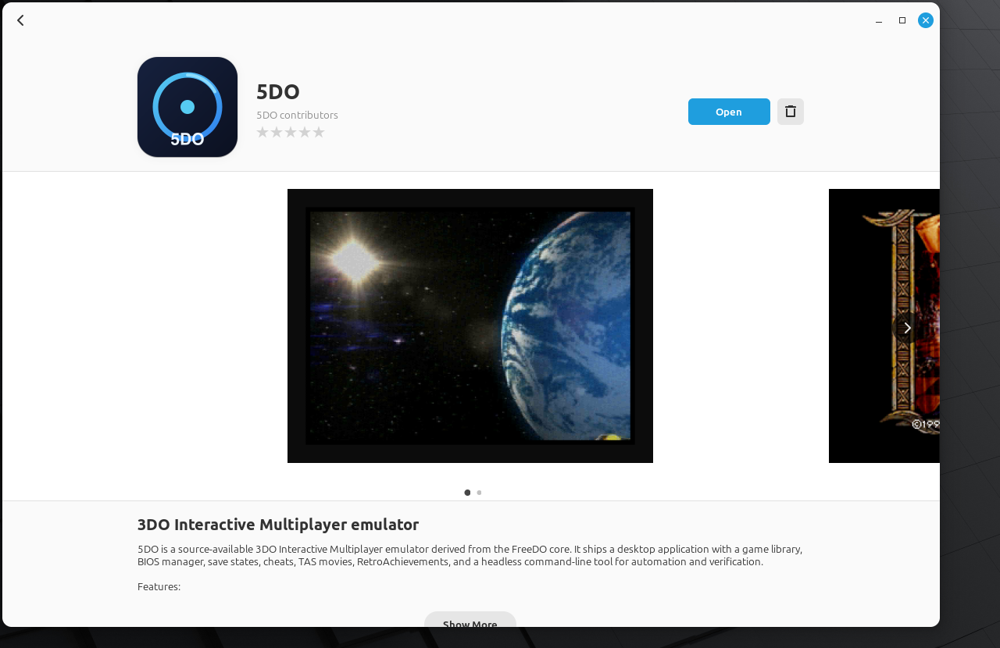

# Linux distribution, signing, and publishing

This page covers how the Linux artifacts are built, signed, published, and announced,
and what else can move Linux adoption. It is the working reference for
[Installers.md](Installers.md) and the Linux rows in
[ImplementationPlan.md](ImplementationPlan.md) §3.3.

**Snapshot:** 2026-11-17, v1.12.0. Linux x64 is a validated target (hardware
OpenGL/Vulkan, real-device audio, evdev gamepads, display-sleep inhibit, full
acceptance pass); Linux arm64 passes native runtime smoke.

---

## 1. What ships today

| Artifact | Built by | Purpose |
|---|---|---|
| `5do-<version>-linux-x64.tar.gz` | `build-bundle.yml` | Portable x64 bundle (primary artifact) |
| `5do-<version>-linux-arm64.tar.gz` | `build-bundle.yml` | Portable arm64 bundle |
| `5do-<version>-linux-<arch>.tar.gz.asc` | `linux-packages.yml` | Detached signature for each portable bundle |
| `5do_<version>_amd64.deb` | `packaging/linux/build-deb.sh` | Debian/Ubuntu/Mint install, desktop entry, MIME, AppStream |
| `5do_<version>_arm64.deb` | `packaging/linux/build-deb.sh` | arm64 variant |
| `5do-<version>-1.x86_64.rpm` | `packaging/linux/build-rpm.sh` | Fedora/RHEL/openSUSE install |
| `5do-<version>-1.aarch64.rpm` | `packaging/linux/build-rpm.sh` | arm64 variant |
| `5do-x86_64.AppImage`, `5do-aarch64.AppImage` (+ `.zsync`) | `packaging/linux/build-appimage.sh` | No-install single file, zsync updates |
| `5do-x86_64.flatpak`, `5do-aarch64.flatpak` | `packaging/linux/build-flatpak.sh` | Sandboxed install for software centers and Steam Deck |
| `SHA256SUMS-linux.txt` (+ `.asc`) | `linux-packages.yml` | Signed checksum manifest for the `.deb`/`.rpm`/AppImage/Flatpak artifacts |
| `5do-archive-keyring.gpg` (+ `.asc`) | `sign-artifacts.sh` | Public release key |
| `SHA256SUMS.txt` | `release.yml` | Unsigned checksum manifest for the bundles and packages |

The `.deb`/`.rpm` packages are **self-contained**: the .NET 11 runtime is embedded in
the apphosts, so the packages never depend on `dotnet-runtime-*`. They depend on the
X11, fontconfig, freetype, glib, and GL libraries that Avalonia and Skia load at run
time.

The `.flatpak` bundles are self-contained in the same sense, but the Flatpak sandbox
still needs the freedesktop runtime: `flatpak install ./5do-x86_64.flatpak` fetches
`org.freedesktop.Platform//26.08` from Flathub if it is missing. The manifest packages
the published apphosts, so no .NET SDK extension is involved, and both bundles use the
same `io.github.purelogiccode.FiveDO` app ID and `stable` branch. Because the sandbox
sets `HOME` to the per-app directory, a Flatpak install keeps its settings, save states,
and BIOS folder under `~/.var/app/io.github.purelogiccode.FiveDO/`; `--filesystem=home`
still lets the file picker reach BIOS and disc images in the real home directory.

---

## 2. What "signing" means on Linux

There is no Linux equivalent of Windows Authenticode or Apple notarization for a
general-purpose application:

- The kernel does not verify a signature before executing an ELF binary.
- A `.deb` has no per-package cryptographic signature that APT checks; APT trusts the
  **repository index**.
- `dpkg-sig` was removed from Debian; `debsig-verify` exists but is not used by the
  archive.
- RPM packages *can* carry a header signature, and dnf checks it only when
  `gpgcheck=1`.
- AppImages can embed a GPG signature, but nothing enforces it.

So "signing the Linux build" means building a **trust chain around the download**:

| Link | What is signed | What verifies it |
|---|---|---|
| Release key | The 5DO public key, published as `5do-archive-keyring.gpg` | Fingerprint pinned in this documentation and the release notes |
| Release assets | `SHA256SUMS-linux.txt.asc` and a detached `.asc` per artifact | `gpg --verify` + `sha256sum -c` |
| RPM package (optional) | RPM header signature | `rpm --checksig` |
| AppImage (optional) | Embedded signature | `./5do-x86_64.AppImage --appimage-signature` |
| Repository metadata (optional) | `InRelease`/`Release.gpg` and `repomd.xml.asc`, only if you mirror the packages into your own repository | `apt update` / `dnf` with the keyring |

Signing does **not** sandbox the app, scan it for malware, or provide auto-updates. It
only proves that the bytes came from the 5DO release key.

---

## 3. Verifying a download

```sh
# 1. Inspect the key before trusting it. The fingerprint must match the value
#    published in this document (see §4) and in the release notes.
curl -fsSLO https://github.com/purelogiccode/5DO/releases/latest/download/5do-archive-keyring.gpg.asc
gpg --show-keys --with-fingerprint 5do-archive-keyring.gpg.asc

# 2. Verify the Linux checksum manifest, then the artifacts.
gpg --verify SHA256SUMS-linux.txt.asc SHA256SUMS-linux.txt
sha256sum -c SHA256SUMS-linux.txt

# 3. Verify an individual artifact signature (equivalent to step 2).
gpg --verify 5do_1.12.0_amd64.deb.asc 5do_1.12.0_amd64.deb

# 4. The portable bundles and the Flatpak bundles carry their own detached signature;
#    SHA256SUMS-linux.txt covers the .deb/.rpm/AppImage/Flatpak artifacts.
gpg --verify 5do-1.12.0-linux-x64.tar.gz.asc 5do-1.12.0-linux-x64.tar.gz
gpg --verify 5do-x86_64.flatpak.asc 5do-x86_64.flatpak
```

```sh
# RPM package header signature, when the package was built with --sign-key.
rpm --checksig 5do-1.12.0-1.x86_64.rpm

# AppImage embedded signature.
chmod +x 5do-x86_64.AppImage
./5do-x86_64.AppImage --appimage-signature
```

5DO publishes the packages as **GitHub release assets**. There is no project-hosted
`apt`/`dnf` repository, so install the downloaded file directly; the distribution
resolves the declared dependencies from its own archives.

```sh
# Debian, Ubuntu, Linux Mint
sudo apt install ./5do_1.12.0_amd64.deb
5do --version

# Fedora, RHEL, openSUSE
sudo dnf install ./5do-1.12.0-1.x86_64.rpm
5do --version

# Portable AppImage (no install, no runtime dependency)
chmod +x 5do-x86_64.AppImage
./5do-x86_64.AppImage

# Flatpak (sandboxed; the freedesktop runtime is fetched from Flathub if missing)
flatpak install --user ./5do-x86_64.flatpak
flatpak run io.github.purelogiccode.FiveDO
```

`apt`/`dnf` accept a local path because it contains a slash; they do not need a
repository entry. Removing the package is the normal `apt remove 5do` /
`dnf remove 5do`.

If you operate a fleet and want a repository, §5.1 shows how to mirror the signed
packages; that is an optional deployment detail, not a 5DO service.

Never use `[trusted=yes]` or `repo_gpgcheck=0` on a repository you did not sign
yourself; both disable the only integrity check APT/dnf perform.

---

## 4. Key setup runbook (one time)

Create an offline primary key with an online signing subkey. Only the signing subkey
goes into CI; the primary key stays off the network and is used to extend or revoke
the subkey.

```sh
export GNUPGHOME="$HOME/.gnupg-5do"
mkdir -p "$GNUPGHOME" && chmod 700 "$GNUPGHOME"

# Primary (certify-only) key + signing subkey, no passphrase on the subkey so CI can
# use it unattended. Keep the primary key offline.
gpg --batch --quick-generate-key "5DO release signing <release@5do.invalid>" \
  ed25519 cert 2y
fpr="$(gpg --batch --with-colons --fingerprint | awk -F: '/^fpr:/ { print $10; exit }')"
gpg --batch --quick-add-key "$fpr" ed25519 sign 1y

gpg --batch --list-secret-keys --with-subkey-fingerprint
```

Export the **signing subkey only** for GitHub Actions:

```sh
# Replace SIGNING_SUBKEY_FPR with the `ssb` fingerprint from the listing above.
gpg --batch --armor --export-secret-subkeys "$SIGNING_SUBKEY_FPR"! > 5do-signing-subkey.asc
gh secret set LINUX_GPG_PRIVATE_KEY < 5do-signing-subkey.asc
gh secret set LINUX_GPG_KEY_ID --body "$SIGNING_SUBKEY_FPR"
shred -u 5do-signing-subkey.asc
```

Rules:

- Never commit a private key, and never put the primary key in a repository secret.
- Rotate the signing subkey before it expires; publish the new fingerprint in the
  release notes. The old signatures remain verifiable with the old keyring.
- If a key is compromised, publish a revocation certificate and a new keyring. Do not
  silently replace `5do-archive-keyring.gpg`.
- Record the fingerprint here and in `docs/ReleaseNotes-<version>.md`:

| Item | Value |
|---|---|
| Key ID | _to be recorded when the first signed release runs_ |
| Fingerprint | _to be recorded when the first signed release runs_ |
| Expires | _to be recorded when the first signed release runs_ |

Without the secret the release still builds: `linux-packages.yml` logs a warning,
publishes unsigned packages, and skips the signature files. The release evidence must
then say "unsigned".

---

## 5. Where the packages live

The Linux artifacts are **GitHub release assets**, next to the portable bundles:

| Asset | Install |
|---|---|
| `5do_<version>_amd64.deb`, `5do_<version>_arm64.deb` | `sudo apt install ./5do_<version>_amd64.deb` |
| `5do-<version>-1.x86_64.rpm`, `5do-<version>-1.aarch64.rpm` | `sudo dnf install ./5do-<version>-1.x86_64.rpm` |
| `5do-x86_64.AppImage` (and `.zsync`), `5do-aarch64.AppImage` (and `.zsync`) | `chmod +x` and run |
| `5do-x86_64.flatpak`, `5do-aarch64.flatpak` | `flatpak install --user ./5do-<arch>.flatpak` |
| `SHA256SUMS-linux.txt` (+ `.asc`) | `gpg --verify` + `sha256sum -c` |
| `5do-archive-keyring.gpg` (+ `.asc`) | Trust anchor for every signature |

There is **no project-hosted APT/RPM repository and no second repository to maintain**.
`apt` and `dnf` install a local file directly (a path containing `/` is treated as a
package file), and dependency resolution still comes from the distribution's own
archives. Release assets are immutable per tag, so the versioned packages always
resolve; `releases/latest/download/5do-x86_64.AppImage` and
`releases/latest/download/5do-x86_64.flatpak` are the stable URLs only for the
unversioned single-file artifacts.

### 5.1 Optional: mirror the packages

If you run a fleet and want `apt install 5do` / `dnf install 5do` from your own
infrastructure, build a repository from the downloaded release files with the scripts in
`packaging/linux/`. This is a deployment choice, not a 5DO service, and nothing in the
project needs to be created for it.

The scripts sign the repository metadata with `LINUX_GPG_KEY_ID` and publish the matching
public key at the repository root as `5do-archive-keyring.gpg` (plus `.asc` and
`.fingerprint`), because that is the URL written into the generated `5do.list` and
`5do.repo`. `LINUX_GPG_HOME` selects a non-default keyring. Pass `--no-keyring` when your
pipeline publishes the key elsewhere.

```sh
# Build or update both trees. The scripts are additive: the package pool keeps every
# release, so pinned versions stay installable, and the indexes are regenerated from the
# whole pool on each run.
export LINUX_GPG_KEY_ID=<fingerprint of the release signing key>   # §4

bash packaging/linux/build-apt-repo.sh \
  --repo-dir /srv/5do/apt --suite stable \
  --base-url https://mirror.example.internal/5do/apt \
  --key-id "$LINUX_GPG_KEY_ID" /srv/5do/debs

bash packaging/linux/build-rpm-repo.sh \
  --repo-dir /srv/5do/rpm \
  --base-url https://mirror.example.internal/5do/rpm \
  --key-id "$LINUX_GPG_KEY_ID" --gpgcheck 0 /srv/5do/rpms
```

| Tree | Signed metadata | Everything else |
|---|---|---|
| `apt/` | `dists/<suite>/InRelease` (clearsigned), `Release.gpg`, `Release` | `dists/<suite>/main/binary-<arch>/Packages(.gz)`, `pool/main/<letter>/<package>/<file>.deb`, `5do.list`, `5do-archive-keyring.gpg` (+ `.asc`, `.fingerprint`), `README.md` |
| `rpm/` | `<arch>/repodata/repomd.xml.asc` | `<arch>/5do-<version>-1.<arch>.rpm`, `<arch>/repodata/repomd.xml` and the compressed indexes, `5do.repo`, `5do-archive-keyring.gpg` (+ `.asc`, `.fingerprint`), `README.md` |

Serve the two directories from any static host — a web server, S3/R2, an internal mirror,
or a subdirectory of a Pages site you already run — then point the client at the published
keyring and repository file:

```sh
# Debian, Ubuntu, Linux Mint
sudo install -d -m 0755 /etc/apt/keyrings
curl -fsSL https://mirror.example.internal/5do/apt/5do-archive-keyring.gpg \
  | sudo tee /etc/apt/keyrings/5do-archive-keyring.gpg >/dev/null
curl -fsSL https://mirror.example.internal/5do/apt/5do.list \
  | sudo tee /etc/apt/sources.list.d/5do.list >/dev/null
sudo apt update && sudo apt install 5do

# Fedora, RHEL, openSUSE
sudo rpm --import https://mirror.example.internal/5do/rpm/5do-archive-keyring.gpg
sudo curl -fsSL https://mirror.example.internal/5do/rpm/5do.repo \
  -o /etc/yum.repos.d/5do.repo
sudo dnf install 5do
```

`repo_gpgcheck=1` is what makes dnf verify `repodata/repomd.xml`. The generated repo file
sets `gpgcheck=0` because the release packages are not header-signed; passing
`--sign-key` to `build-rpm.sh` adds that layer if you build your own packages.

Both trees grow by roughly 120-160 MB per release for both architectures. Prune
deliberately and rebuild the indexes afterwards.

**Validated 2026-11-17** with the 1.12.0 packages and a throwaway ed25519 key, because the
project release key does not exist yet (§4). APT and dnf verified the metadata with only
the keyring the script published, and every client rejected a tampered index:

| Client | OS / tool | Result |
|---|---|---|
| Debian | 13 (trixie), apt 3.0.3, dpkg 1.22.22 | `apt-get update` verified `InRelease`; `apt-get install 5do` installed 1.12.0 with the distro's X11/GL deps; `5do-cli --version` → `5DO 1.12.0`, `selftest --json` ok; `apt-get remove` cleaned up |
| Debian family | Ubuntu 22.04.1, apt 2.4.8 | `apt-get update`, `apt-get install 5do`, `5do-cli --version` → `5DO 1.12.0`, `selftest --json` ok, `apt-get remove` cleaned up |
| Linux Mint | 22.3, apt 2.8.3 (Mint wrapper) | install from the mirror, desktop entry/metainfo/MIME present, `desktop-file-validate` clean, `selftest` ok, `apt-get remove` cleaned up |
| Fedora | 45, dnf5 5.4.6 | keyring imported from the mirror URL, signed `repomd.xml` accepted, `dnf install 5do` (with distro deps) → `5do-cli selftest` ok, `dnf remove` cleaned up |
| Tamper check | all three | a modified `Packages`/`Packages.gz` fails APT with a hash mismatch; a modified `repomd.xml` fails dnf with `Bad PGP signature` and the repository is not used |

Evidence: [TestCorpus.md](TestCorpus.md) §1.1cn. CI runs the same scripts with a
throwaway key in `linux-packages.yml` and asserts the signed metadata and keyring.

### 5.2 Software-center appearance (2026-11-18)

The shipped AppStream metadata was checked in a real software center, not only with
`appstreamcli`. `5do_1.12.0_amd64.deb` was installed on Linux Mint 22.3 (Cinnamon) with
GNOME Software 46.0:

- The **Installed** list shows *5DO* with the 256 px application icon, and the details page
  shows the name, developer (*5DO contributors*), summary, full description, both
  screenshots, and an **Open** button.
- The AppStream cache picked the component up after `appstreamcli refresh --force`;
  `appstreamcli get io.github.purelogiccode.FiveDO` reports the name, summary, homepage,
  and `Icon: 5do`, and `appstreamcli validate --no-net` passes with one pedantic hint
  (`cid-contains-uppercase-letter`) that is required by the existing Flatpak app ID.
- MIME typing is unchanged for real discs: a file with the ISO-9660 `CD001` signature is
  still typed `application/vnd.efi.iso` (the canonical name, aliased to
  `application/x-iso9660-image` and `application/x-cd-image`), never
  `application/x-3do-disc`. 5DO is the registered handler for `application/x-3do-disc`,
  `application/x-cd-image`, and `application/x-iso9660-image`; `.bin` maps to the 3DO type
  and `.cue` keeps the system `application/x-cue` type. `desktop-file-validate` accepts
  the entry.
- The `.rpm` installs the same five metadata files (desktop entry, 256 px PNG, SVG,
  metainfo, MIME XML); KDE Discover was not exercised because no Plasma host was
  available, and it reads the same AppStream data.



Evidence: [TestCorpus.md](TestCorpus.md) §1.1cp.

---

## 6. Releasing and validating

```sh
# Local: build, sign, and install-test the Linux set.
bash packaging/linux/build-deb.sh  --bundle artifacts/bundle/linux-x64 --rid linux-x64
bash packaging/linux/build-rpm.sh  --bundle artifacts/bundle/linux-x64 --rid linux-x64
APPIMAGETOOL=/path/to/appimagetool/AppRun bash packaging/linux/build-appimage.sh \
  --bundle artifacts/bundle/linux-x64 --output artifacts/installers --name 5do-x86_64.AppImage
bash packaging/linux/build-flatpak.sh --bundle artifacts/bundle/linux-x64 --rid linux-x64 \
  --output artifacts/installers --runtime-version 26.08
bash packaging/linux/sign-artifacts.sh --key-id "$KEY" \
  --keyring-out artifacts/signing/5do-archive-keyring.gpg artifacts/installers
bash packaging/linux/build-apt-repo.sh --repo-dir artifacts/mirror/apt \
  --base-url https://mirror.example.org/5do/apt --key-id "$KEY" artifacts/installers
bash packaging/linux/build-rpm-repo.sh --repo-dir artifacts/mirror/rpm \
  --base-url https://mirror.example.org/5do/rpm --key-id "$KEY" --gpgcheck 0 \
  artifacts/installers
sudo apt install ./artifacts/installers/5do_1.12.0_amd64.deb
```

CI (`linux-packages.yml`, called by `release.yml`) already:

- builds AppImage and Flatpak bundles for both architectures;
- validates `5do.desktop`, the MIME XML, the AppStream metainfo, and the package
  contents (`dpkg-deb`, `rpm -qlp`);
- imports the signing subkey and signs every artifact and the checksum manifest;
- installs the `.deb` with `apt-get install`, checks the generated symlinks, desktop
  entry, MIME, metainfo, and icon, runs `5do --version`, `5do-cli selftest --json`, and
  `5do-cli doctor`, then removes the package and verifies the removal;
- installs each `.flatpak` and runs `5do-cli --version` and `5do-cli selftest --json`
  inside the sandbox;
- publishes `5do-linux-installers` (packages, signatures, checksums, keyring), which
  `release.yml` attaches to the GitHub release.

Local acceptance on a real Linux host:

```sh
# Debian/Ubuntu/Mint
sudo apt install ./5do_1.12.0_amd64.deb
5do --version && 5do-cli selftest --json
5do --smoke-test --smoke-output /tmp/smoke.txt   # needs a display or xvfb-run

# Fedora
sudo dnf install ./5do-1.12.0-1.x86_64.rpm
rpm --checksig ./5do-1.12.0-1.x86_64.rpm

# AppImage without FUSE (containers, minimal installs)
./5do-x86_64.AppImage --appimage-extract-and-run --version

# Flatpak bundle, including the CLI inside the sandbox
flatpak install --user ./5do-x86_64.flatpak
flatpak run --command=5do-cli io.github.purelogiccode.FiveDO selftest --json
```

Record the results in [TestCorpus.md](TestCorpus.md) and
[Installers.md](Installers.md), per the evidence rule in
[ImplementationPlan.md](ImplementationPlan.md).

---

## 7. Publishing and announcement channels

Ordered by effort-to-reach. The first three are under the project's control and should
exist before any outreach.

| # | Channel | Audience | Effort | Gate / action |
|---|---|---|---|---|
| 1 | GitHub Releases | Existing users | Done | Publishes bundles, signed packages, AppImage, keyring, and checksums |
| 2 | Signed `.deb`/`.rpm` downloads | Distro users | Done | `apt install ./5do_<version>_amd64.deb` / `dnf install ./5do-<version>-1.x86_64.rpm` |
| 3 | AppImage download | No-install users | Done in CI | `5do-x86_64.AppImage` / `5do-aarch64.AppImage` + `.zsync` |
| 4 | [AppImageHub](https://appimage.github.io/) | AppImage browsers | S | Pull request adding a data entry to the AppImage catalog |
| 5 | [AUR](https://aur.archlinux.org/) (`5do-bin`) | Arch/Manjaro/Endeavour, Steam Deck | S | PKGBUILD (§8.1) |
| 6 | [itch.io](https://itch.io/) | Retro/indie players | S | Free project page; upload AppImage, Flatpak, tarball |
| 7 | [Flathub](https://flathub.org/) | GNOME/KDE software centers, Steam Deck | L | Licence review first (§9); then a Flatpak manifest and a Flathub app submission |
| 8 | Self-hosted Flatpak | KDE/GNOME users | Done in CI | Single-file `5do-<arch>.flatpak`; add `flatpak build-update-repo` with the 5DO key if a hosted repository is wanted |
| 9 | Snap Store | Ubuntu users | M | `snapcraft.yaml` with `strict` confinement, store review |
| 10 | EmuDeck / RetroDeck / EmulationStation | Steam Deck and HTPC users | M | Upstream pull request adding 5DO as a 3DO option |
| 11 | GamingOnLinux, Boiling Steam, Phoronix | Linux gaming readers | S | News submission; Phoronix for Vulkan/Wayland milestones, not routine releases |
| 12 | `r/linux_gaming`, `r/emulation`, `r/3DO`, `r/SteamDeck` | Core communities | S | One release-day post, no cross-post spam |
| 13 | Hacker News / Lobsters | Developers | S | Only for a genuinely novel technical story |
| 14 | YouTube (ETA Prime, Gardiner Bryant, The Linux Experiment, Brodie Robertson) | Mass Linux audience | S | Send early access to a release plus a short demo clip |
| 15 | Emulation General Wiki, AlternativeTo | Search traffic | S | Add/edit a 5DO page with the platform matrix |
| 16 | Linux distro archives (Debian, Ubuntu, Fedora) | Everyone | XL | Blocked on licence and network-free builds (§9) |

### Release announcement template

The first paragraph should be the one sentence a reader repeats to a friend:

> 5DO 1.12.0 is a 3DO emulator for Windows, Linux, and Apple Silicon macOS. Linux
> ships as a signed Debian package, an RPM, and a portable AppImage you can install
> straight from the release page. It needs no runtime install, supports OpenGL and
> Vulkan, and runs the 378-title compatibility set.

Then, in order: what changed, how to install (one command per distro), how to verify
the signature, where to report a problem, and one screenshot or short clip. Keep the
BIOS requirement explicit — it is the single most common support question.

### Cadence

- Announce on release day, then once more only if a point release fixes something
  users reported.
- Keep a `docs/ReleaseNotes-<version>.md` page for every release; news sites and
  package maintainers link to it.
- Track per-asset download counts with the GitHub API as the only honest metric; there
  is no telemetry in 5DO and there should not be.

---

## 8. Channel details

### 8.1 AUR (Arch, Manjaro, EndeavourOS, Steam Deck)

`5do-bin` is the right first package: it repacks the released tarball, so it stays in
sync with the validated build. AUR also requires a `5do-git` package only if there is
demand; do not start with it. The maintained reference copy, with build and submission
steps, is `packaging/linux/aur/` in this repository.

```bash
# PKGBUILD sketch for 5do-bin. Fill in both checksums from the release.
# The maintained copy is packaging/linux/aur/PKGBUILD.
pkgname=5do-bin
pkgver=1.12.0
pkgrel=1
pkgdesc="3DO Interactive Multiplayer emulator"
arch=('x86_64' 'aarch64')
url="https://github.com/purelogiccode/5DO"
license=('custom:FreeDO')
depends=('glibc' 'gcc-libs' 'zlib' 'libx11' 'libice' 'libsm' 'libxext'
         'libxrandr' 'libxi' 'libxcursor' 'glib2' 'fontconfig' 'freetype2'
         'libglvnd')
optdepends=('mesa: OpenGL rendering' 'python-dbus: display-sleep inhibit')
options=('!strip')

case "$CARCH" in
  x86_64)  _rid=linux-x64 ;;
  aarch64) _rid=linux-arm64 ;;
esac
_asset="5do-$pkgver-$_rid.tar.gz"

source=("$url/releases/download/v$pkgver/$_asset")
noextract=("$_asset")
sha256sums_x86_64=('REPLACE_WITH_X64_SHA256')
sha256sums_aarch64=('REPLACE_WITH_ARM64_SHA256')

package() {
  install -d "$pkgdir/opt/5do"
  bsdtar -x -f "$srcdir/$_asset" -C "$pkgdir/opt/5do"
  rm -f "$pkgdir/opt/5do/5do.desktop"

  install -d "$pkgdir/usr/bin" "$pkgdir/usr/share/applications" \
    "$pkgdir/usr/share/metainfo" "$pkgdir/usr/share/mime/packages" \
    "$pkgdir/usr/share/icons/hicolor/scalable/apps" \
    "$pkgdir/usr/share/icons/hicolor/256x256/apps"
  ln -s /opt/5do/FiveDo "$pkgdir/usr/bin/5do"
  ln -s /opt/5do/FiveDo.Cli "$pkgdir/usr/bin/5do-cli"

  # The bundle ships desktop-integration reference files under packaging/.
  _pkg="$pkgdir/opt/5do/packaging"
  install -m 0644 "$_pkg/5do.desktop" "$pkgdir/usr/share/applications/"
  install -m 0644 "$_pkg/5do.xml" "$pkgdir/usr/share/mime/packages/"
  install -m 0644 "$_pkg/io.github.purelogiccode.FiveDO.metainfo.xml" \
    "$pkgdir/usr/share/metainfo/"
  install -m 0644 "$_pkg/5do.svg" \
    "$pkgdir/usr/share/icons/hicolor/scalable/apps/"
  install -m 0644 "$_pkg/5do-256.png" \
    "$pkgdir/usr/share/icons/hicolor/256x256/apps/5do.png"
  rm -rf "$_pkg"
}
```

The bundle tarball has no top-level directory, so the PKGBUILD extracts it with
`noextract` + `bsdtar` rather than letting makepkg unpack it into `$srcdir`.

`!strip` is required: the apphost is a self-contained single-file executable and
stripping it can corrupt the embedded runtime.

### 8.2 AppImageHub

Open a pull request against the AppImage catalog repository with a data entry pointing
at the release asset URL, license, categories, and a screenshot. The catalog is
generated from those files, so the entry must name the exact published assets
(`5do-x86_64.AppImage`, `5do-aarch64.AppImage`) and their update information.

Remember that AppImages need FUSE 2 on Ubuntu 22.04+. Document
`--appimage-extract-and-run` for containers and minimal installs, and consider
shipping `libfuse2` as an optional dependency in the `.deb`.

### 8.3 Flatpak and Flathub

A Flatpak is the highest-value Linux channel after AppImage, because it is what GNOME
Software, KDE Discover, and the Steam Deck's Discover store show. The single-file
`5do-<arch>.flatpak` bundles are built in CI from the published apphosts
(`packaging/linux/build-flatpak.sh` and `io.github.purelogiccode.FiveDO.yml`), so users
can install 5DO from a file today. Two constraints still gate **Flathub**:

1. Flathub's build system has no network access and expects a source build. A
   .NET app needs the `org.freedesktop.Sdk.Extension.dotnet11` SDK extension and a
   `dotnet publish` step, or a vendored NuGet cache. The release `.flatpak` avoids
   this by packaging the published tree, but that is not how Flathub builds.
2. The licence must permit redistribution. See §9 before starting.

For a self-hosted repository (`flatpak build-export`,
`flatpak build-update-repo --gpg-sign=$KEY`, served from any static host you already
run), keep the OSTree repository with `build-flatpak.sh --repo-dir` instead of shipping
only the single-file bundle, then submit to Flathub once the licence position is
settled.

Expected permissions: `--share=network` (RetroAchievements, metadata lookup),
`--socket=pulseaudio`, `--socket=x11`, `--socket=wayland`, `--device=all` (gamepads,
optical drives), `--filesystem=home` (BIOS and images), `--filesystem=removable-media`
(disc images on USB drives), `--talk-name=org.freedesktop.ScreenSaver` (display-sleep
inhibit).

### 8.4 Snap

`snapcraft.yaml` with `base: core24`, `confinement: strict`, and plugs `home`,
`removable-media`, `joystick`, `pulseaudio`, `opengl`, `x11`, `wayland`,
`desktop`, `network`. `removable-media` and `joystick` are not auto-connected, so the
store listing must tell users to run `snap connect 5do:removable-media`. The Snap Store
allows proprietary apps but reviews them; the non-commercial clause needs the same
decision as Flathub.

### 8.5 Steam Deck and EmuDeck

The evdev gamepad path and display-sleep inhibit are validated on real hardware, so the
remaining work is packaging and presentation:

- Publish an AppImage with an embedded `--fullscreen` desktop action, and document
  adding it as a non-Steam game.
- Add 5DO as an option in EmuDeck/RetroDeck's 3DO emulator list through an upstream
  pull request. Those tools install Flatpaks/AppImages for the user and put the entry
  where Deck users look.
- Keep the BIOS requirement in the first-run dialog; Deck users often have no
  keyboard.

### 8.6 Press and community

- **GamingOnLinux** covers emulator releases regularly; send a short news item with
  the release URL, one screenshot, and the "no runtime required" angle.
- **Phoronix** is worth a note only for a graphics milestone (Vulkan surfaces, Wayland,
  Mesa performance), not for version bumps.
- **Reddit** works best as one post in `r/linux_gaming` plus one in `r/3DO`; answer
  questions for the first 24 hours instead of cross-posting everywhere.
- **YouTube** converts better than any text channel. A 60-second clip that boots a
  game, changes a filter, and shows the gamepad working is enough.

---

## 9. Licence reality check

The FreeDO notice reproduced in
[LICENSE](https://github.com/purelogiccode/5DO/blob/master/LICENSE) restricts
commercial use and requires the FreeDO rights holders' approval for it. The project's
own note says 5DO is "non-commercial and source-available only" until that approval
exists.

Consequences:

| Destination | Requirement | Position today |
|---|---|---|
| Debian / Ubuntu archives | [DFSG](https://www.debian.org/social_contract#guidelines): free redistribution, including commercial use | **Blocked.** The non-commercial clause is a field-of-use restriction |
| Fedora / openSUSE repositories | Fedora licensing: redistributable and commercially usable | **Blocked**, same reason |
| Flathub | Licence must permit redistribution; non-commercial apps need an explicit decision | **Needs review.** Ask Flathub before building the manifest |
| Snap Store | Proprietary apps allowed; publisher must have distribution rights | **Needs review** of the same clause |
| AUR | Must be legally redistributable; no charge is made for the package | **Probably fine**, but keep the notice and attribution in the package |
| Self-hosted APT/RPM/AppImage | The project distributes its own build | **Fine**; attribution and the licence text ship in the package |
| itch.io | Free downloads under the project's own terms | **Fine** |

Two paths clean this up:

1. Ask the FreeDO rights holders for written permission or a licence clarification. If
   they grant commercial-use rights, the Debian/Fedora/Flathub question mostly
   disappears (network-free builds and vendored NuGet packages remain the technical
   work).
2. Keep the FreeDO-derived core under the current terms and license the 5DO-specific
   code (frontend, CLI, tooling) separately. That does not help the combined binary,
   because the core is linked into both apphosts; the archives package the combined
   binary, so the restriction still applies.

Until one of those happens, treat official distro archives as out of scope and put the
effort into signed release downloads, AppImage, AUR, and Steam Deck channels. Record
the decision in [ReleaseLegalReview.md](ReleaseLegalReview.md).

> This section is engineering guidance, not legal advice. Get a lawyer's read before
> submitting to a store that reviews licences.

---

## 10. Adoption backlog (Linux)

Ordered by impact on "does a Linux user get a working game today". Each item is a
candidate for the [ImplementationPlan.md](ImplementationPlan.md) backlog; none is
committed until it has an ID.

| Priority | Item | Why it matters | Effort |
|---|---|---|---|
| P0 | **BIOS auto-discovery** | Every new user hits "no BIOS". Scan `~/.local/share/5DO/bios`, `~/BIOS`, `~/Documents/BIOS`, and the folder next to the executable, then offer a one-click "use this BIOS" prompt. Never download ROMs. **Implemented:** `bios discover`, the first-run **Use this BIOS** button, and the `doctor` BIOS row | S |
| P0 | **`5do-cli doctor`** | A single command that dumps distro, session type, GL/Vulkan renderer, audio device, gamepad permissions (`input` group, `/dev/uinput`), XDG paths, and the last 200 log lines. Cuts support round-trips and gives useful bug reports. **Implemented:** `5do-cli doctor [--json] [--strict]` reports session, data-folder access, disk space, native libraries, evdev/optical devices, settings, and BIOS discovery | M |
| P0 | **Wayland guidance and fallback check** | X11/XWayland works today; Wayland-only sessions fall back to the slower offscreen path. Detect `WAYLAND_DISPLAY` without `DISPLAY`, warn once, and document the XWayland workaround. **Implemented:** `5do-cli doctor` reports the case and the shell logs it once and shows a status-line hint | S |
| P1 | **AppImage auto-update** | Embed zsync info and surface a newer release. **Implemented:** the AppImage embeds zsync update information and the existing startup/`update` check offers the release page; remaining work is an in-app download if wanted | M |
| P1 | **Steam Deck preset** | A Deck-friendly on-screen hint for the BIOS step and documented non-Steam-game setup. **Implemented:** the desktop entry has a **Play in fullscreen** action; the BIOS hint and EmuDeck entry stay as `REL-10` | S |
| P1 | **Self-hosted Flatpak** | Discover-store visibility without waiting for Flathub. **Implemented:** `build-flatpak.sh` produces `5do-<arch>.flatpak` bundles for x64 and arm64, covered by the GPG signatures; a hosted repository is optional | M |
| P1 | **EmuDeck/RetroDeck entry** | Where Deck users actually look for emulators | S |
| P1 | **Flatpak on Flathub** | Largest Linux app store; needs the licence decision and a network-free build | L |
| P1 | **Snap** | Ubuntu's default store; confinement work | M |
| P2 | **Native Wayland surface** | Removes the XWayland dependency for the Vulkan child surface and future-proofs for Fedora/KDE defaults | L |
| P2 | **Ubuntu PPA / Fedora COPR** | Direct `apt`/`dnf` installs without hosting a repository; Launchpad and Copr builders are network-free, so this needs vendored NuGet packages | M |
| P2 | **Debian/Ubuntu/Fedora archives** | Widest reach; blocked on licence and network-free builds | XL |
| P2 | **Crash reporter opt-in** | Attach the `doctor` output plus a backtrace to a prefilled issue | M |

Two things that are *not* worth doing: a `curl | bash` installer (unverifiable and
blocked by most corporate proxies), and an x86-only static build (the self-contained
bundle already has no runtime dependency).

---

## 11. Evidence checklist for a signed Linux release

- [ ] `linux-packages.yml` built `.deb`/`.rpm` and AppImage/Flatpak bundles for x64 and
      arm64.
- [ ] Each `.flatpak` installs with `flatpak install --user ./5do-<arch>.flatpak` and
      `flatpak run --command=5do-cli io.github.purelogiccode.FiveDO selftest --json`
      passes inside the sandbox on a matching host.
- [ ] The Linux tarball contains `packaging/5do.desktop`, `5do.xml`, the metainfo, and
      both icons, and `desktop-file-validate` accepts the fullscreen action.
- [ ] `5do-cli doctor --strict` reports no unexpected warnings on the target host, and
      `bios discover` finds the test BIOS.
- [ ] `desktop-file-validate` and `appstreamcli validate --no-net` pass (also in CI).
- [ ] `dpkg-deb -f` shows no `dotnet-runtime` dependency and the expected X11/font deps.
- [ ] `apt-get update` is not required: `sudo apt install ./5do_<version>_amd64.deb`
      succeeds on the target host with the published dependency list, and the optional
      mirror scripts still produce signed `InRelease`/`Release.gpg` when a mirror is
      wanted.
- [ ] `build-apt-repo.sh` and `build-rpm-repo.sh` publish `5do-archive-keyring.gpg` with
      the trees, `gpg --verify` passes on `InRelease` and `repomd.xml.asc` with only that
      keyring, and `apt`/`dnf` install `5do` from a served tree (see §5.1).
- [ ] `gpg --verify` passes for `SHA256SUMS-linux.txt.asc` and every artifact `.asc`
      (including the two portable bundle tarballs); `sha256sum -c SHA256SUMS-linux.txt`
      passes from a clean download.
- [ ] `sudo apt install ./5do_<version>_amd64.deb` succeeds on a stock Debian/Ubuntu
      host (dependency list resolves) and `5do --version` runs; the reverse `apt remove`
      cleans up `/usr/bin/5do`.
- [ ] `sudo dnf install ./5do-<version>-1.x86_64.rpm` succeeds on Fedora.
- [ ] `rpm --checksig` passes when packages were header-signed.
- [ ] `sha256sum -c SHA256SUMS.txt` passes for the five bundles.
- [ ] The key fingerprint is recorded in §4 and in the release notes.
- [ ] `Installers.md`, `TestCorpus.md`, and `ReleaseChecklist.md` record the run.
- [ ] The release page lists every package, both AppImages, both Flatpak bundles, the
      keyring, and both checksum manifests; no repository or extra infrastructure is
      required.
