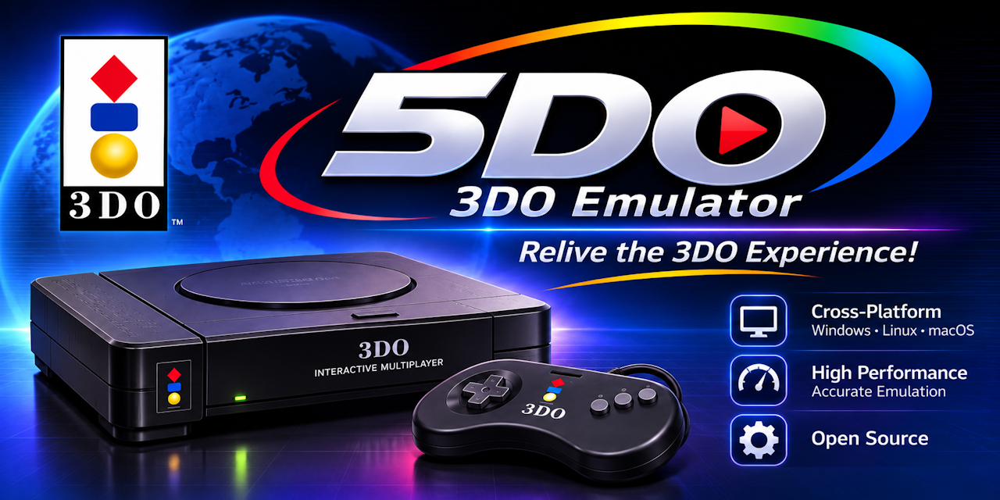

# 5DO Documentation

  

  <strong>A modern, source-available C#/.NET 10 emulator for the 3DO Interactive Multiplayer.</strong>

  
  
  
  
  

!!! important "v1.3 documented compatibility"
    5DO is at the v1.3 documented-compatibility release stage. Windows x64 is the
    validated platform; Linux x64 full suite passed (GPU presentation is
    preview/best-effort). No BIOS ROMs, game images, or extracted game assets are
    distributed here; supply legally obtained files.

## Start here

-   :material-download: **Install and run**

    ---

    Platform requirements, BIOS and disc setup, first run, and data locations.

    [:octicons-arrow-right-24: Installation](Installation.md)

-   :material-gamepad-variant: **User guide**

    ---

    Controls, display filters, save states, rewind, library, recording, cheats, and
    the desktop shell.

    [:octicons-arrow-right-24: User guide](UserGuide.md)

-   :material-help-circle: **FAQ**

    ---

    BIOS, disc formats, releases, performance, platforms, saves, and licensing.

    [:octicons-arrow-right-24: Frequently asked questions](FAQ.md)

-   :material-check-decagram: **Compatibility**

    ---

    Browse the 594-disc loadability sweep, filter by status and region, and open
    per-disc evidence.

    [:octicons-arrow-right-24: Compatibility browser](CompatibilityBrowser.md)
    · [:octicons-arrow-right-24: Compatibility notes](Compatibility.md)

## Choose a path

| I want to... | Read |
|---|---|
| Play games on the desktop app | [Installation](Installation.md), [User guide](UserGuide.md), [FAQ](FAQ.md) |
| Use the headless emulator or automate tests | [CLI reference](CliReference.md), [Diagnostics](Diagnostics.md) |
| Configure settings, profiles, or controllers | [Configuration](Configuration.md), [User guide](UserGuide.md) |
| Understand save states, cheats, or TAS movies | [Save states](SaveStates.md), [Cheats](Cheats.md), [TAS movies](Tas.md) |
| Diagnose a problem | [Troubleshooting](Troubleshooting.md), [Known issues](KnownIssues.md) |
| Build, test, or publish 5DO | [Build and test](BuildAndTest.md), [Test strategy](TestStrategy.md) |
| Contribute code or documentation | [Contributing](https://github.com/purelogiccode/5DO/blob/master/CONTRIBUTING.md), [Developer guide](DeveloperGuide.md), [Documentation guide](Documentation.md) |
| Check the current project position | [Status](Status.md), [Roadmap](Roadmap.md), [Release notes](ReleaseNotes-1.4.0.md) |
| Read the license and attribution rules | [Licensing](Licensing.md), [project license](https://github.com/purelogiccode/5DO/blob/master/LICENSE), [third-party notices](https://github.com/purelogiccode/5DO/blob/master/THIRD-PARTY-NOTICES.md) |

## Current snapshot

**2026-11-07, v1.4.0 release (GitHub Releases).**

- **1,921 tests** are present in the current test assembly.
- The 50-title differential panel matches **50/50 frame hashes** at frames
  60/120/300 with **0 errors**, and **48/50 first PC divergences instruction-align
  to Opera frame 59** (2/50 to frame 119); the only remaining behavioral
  divergence is CD command cadence. The per-command PC/instruction stamps show
  the boot-handoff fix cut a **+207,707 cycle / +86,511 instruction** divergence
  to **-818 / -376**; see
  [`DifferentialHarness.md`](DifferentialHarness.md).
- The library reports **653 games across 1,366 images**; three audio-only CHDs are
  catalogued.
- The first full-collection loadability sweep covered **594 disc images**: **576
  rendered**, **13 black/blank**, and **5 not loadable** on the first pass.
- After triage: **593 loadable/rendered**, **1 known no-video case**
  (`Crash 'n Burn` Japan), and **0 not-loadable rows**.
- Windows x64 is the validated target. Linux x64 full suite passed; GPU
  presentation is preview/best-effort. macOS and arm64 validation are post-1.0.
- v1.4.0 is published on [GitHub Releases](https://github.com/purelogiccode/5DO/releases/tag/v1.4.0)
  as one bundle per system and architecture (Windows/Linux/macOS, x64 and arm64), each with the CLI, desktop app,
  and SHA-256 checksums. The .NET 10 runtime is required on the host and is not bundled.
  The release adds online cover art, run-ahead/frame-delay/VRR/audio-sync latency controls,
  unsigned-disc support, the exact 59.94 Hz NTSC clock, and VDLP/audio fixes. See
  [What's new](WhatsNew.md).

See [Status](Status.md) and [Known issues](KnownIssues.md) for the current position and
the remaining work.

## Documentation map

### Using 5DO

- [Installation](Installation.md) — source builds, CI artifacts, platform notes, data folders.
- [User guide](UserGuide.md) — desktop shell, controls, filters, saves, library, audio, logs.
- [FAQ](FAQ.md) — common questions and short answers.
- [Compatibility browser](CompatibilityBrowser.md) — filterable per-game sweep results with screenshots and evidence.
- [Compatibility notes](Compatibility.md) — BIOS, disc, input, and game-fix compatibility.
- [Game compatibility list](GameCompatibilityList.md) — 241-title 4DO reference and 5DO status.
- [Game compatibility results](GameCompatibilityResults.md) — per-disc sweep evidence.
- [Known issues](KnownIssues.md) — current game, renderer, platform, and packaging limits.
- [Troubleshooting](Troubleshooting.md) — symptom-driven diagnosis.
- [Glossary](Glossary.md) — hardware, emulator, renderer, audio, and release terms.

### Reference

- [CLI reference](CliReference.md) — commands, options, exit codes, JSON, and file formats.
- [Configuration](Configuration.md) — `settings.json`, profiles, paths, input, NVRAM, environment.
- [Cover art](CoverArt.md) — online catalog, WebP pack, matching, R2 hosting, and takedown.
- [Save states](SaveStates.md) — `.tdos` v3 layout, validation, slots, and diffing.
- [Cheats](Cheats.md) — per-game code syntax, desktop manager, and CLI.
- [TAS movies](Tas.md) — `.5domovie` recording, replay, verification, branching, and editing.
- [Audio](Audio.md) — DSP clock, OpenAL output, WAV capture, tap, analysis, and pacing.
- [Video](Video.md) — VDLP, frame assembly, OpenGL/GLES pipeline, filters, and probes.
- [Vulkan](Vulkan.md) — optional Vulkan backend, SPIR-V pipeline, measurements, and limits.
- [Diagnostics](Diagnostics.md) — logs, traces, watchpoints, dumps, probes, and bundles.

### Development and maintenance

- [Architecture](Architecture.md) — dependency rules, runtime composition, and state ownership.
- [Developer guide](DeveloperGuide.md) — source map, invariants, extension points, and conventions.
- [Build and test](BuildAndTest.md) — prerequisites, build/test/format, benchmarks, publish, CI.
- [Test strategy](TestStrategy.md) — unit, integration, golden, differential, fuzz, and performance testing.
- [Porting notes](PortingNotes.md) — C++ to C# rules and reference quirks.
- [Reference strategy](ReferenceStrategy.md) — Opera/libopera hierarchy and differential procedure.
- [Differential harness](DifferentialHarness.md) — manifests, checkpoint hashes, reports, and allowlists.
- [Trimming](Trimming.md) — trim-safe JSON, trimmed publishes, and NativeAOT notes.
- [Documentation guide](Documentation.md) — build the site, preview locally, and publish the wiki.
- [Status](Status.md) — current position, completion estimate, and next steps.
- [Roadmap](Roadmap.md) — concise milestone summary.
- [Implementation plan](ImplementationPlan.md) — master maintainer checklist and progress log.
- [Release checklist](ReleaseChecklist.md) — v1.1 scope and gates.
- [Release legal review](ReleaseLegalReview.md) — attribution and distribution decisions.
- [OpenAL Soft notice](OpenALSoft.md) — LGPL notice, source offer, and relinking rights.
- [Test corpus](TestCorpus.md) — machine-specific BIOS/disc evidence commands (not committed assets).
- [Documentation source guide](DocumentationSource.md) — conventions for editing this documentation set.

## Project links

- [Repository](https://github.com/purelogiccode/5DO)
- [Wiki](https://github.com/purelogiccode/5DO/wiki)
- [Discussions](https://github.com/purelogiccode/5DO/discussions)
- [Issues](https://github.com/purelogiccode/5DO/issues)
- [Contributing](https://github.com/purelogiccode/5DO/blob/master/CONTRIBUTING.md)
- [Code of conduct](https://github.com/purelogiccode/5DO/blob/master/CODE_OF_CONDUCT.md)
- [Security policy](https://github.com/purelogiccode/5DO/blob/master/SECURITY.md)
- [Changelog](https://github.com/purelogiccode/5DO/blob/master/CHANGELOG.md)

---

5DO is **donationware**: non-commercial, source-available software distributed under
the FreeDO modified GNU LGPL. "3DO" and "Panasonic" are trademarks of their respective
owners. 5DO is not affiliated with or endorsed by them.
