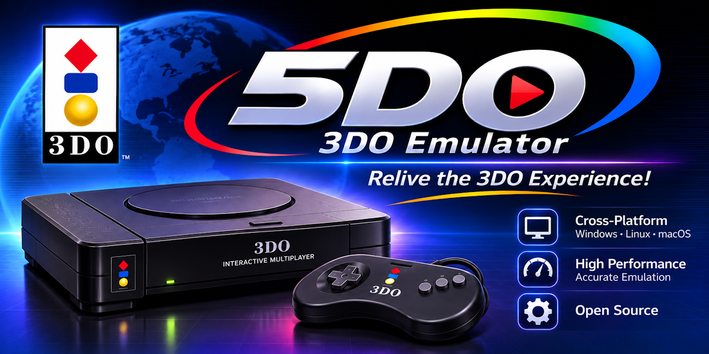

# 5DO Documentation

  

  <strong>A modern, source-available C# 15/.NET 11 emulator for the 3DO Interactive Multiplayer.</strong>

  
  
  
  
  

!!! important "v1.18.1 patch release"
    5DO is at v1.18.1. It adds one-click FFmpeg installation for MP4 recording:
    **Configuration > Install FFmpeg**, the missing-FFmpeg recording prompt, and
    `5do ffmpeg install` fetch a pinned, SHA-256-verified build and place it beside 5DO.
    The 1.18.0 feature set remains: read-only Alcohol MDS/MDX and CloneCD CCD/IMG/SUB disc
    images, optional FFmpeg-based H.264/AAC MP4 recording with Low/Medium/High quality,
    high-refresh frame interpolation, patterned GPU void bars, and live CPU-clock
    changes without restarting the machine. The desktop keeps a rolling autosave under
    `states/autosave/`, written on pause, clean exit, and a configurable interval and
    restored at startup only when the disc game ID and effective BIOS MD5 match.
    ISO, BIN, and CUE+BIN images can also be opened directly from ZIP and 7z archives.
    `--high-res` remains a presentation-only 2x upscale, and retail Gamegun titles keep
    a joypad on port 1. **P** pauses, **Space** toggles fast-forward, **F1** connects the
    Gamegun, and **Alt+Enter** toggles fullscreen.
    **Windows x64, Linux x64, and macOS arm64** are validated targets: macOS presents
    through a native `CAMetalLayer` surface at 60 fps, with all filters and a packaged
    DMG. The macOS arm64 bundle includes MoltenVK and the Vulkan loader; the CPU
    presenter is the fallback. Linux arm64 and Windows arm64 pass the native runtime
    smoke; Intel macOS is unsupported. No BIOS ROMs, game images, or extracted game
    assets are distributed here; supply legally obtained files.

## Start here

-   :material-download: **Install and run**

    ---

    Platform requirements, BIOS and disc setup, first run, and data locations.

    [:octicons-arrow-right-24: Installation](Installation.md)

-   :material-gamepad-variant: **User guide**

    ---

    Controls, display filters, save states, rewind, library, recording, cheats, and
    the desktop shell.

    [:octicons-arrow-right-24: User guide](UserGuide.md)

-   :material-help-circle: **FAQ**

    ---

    BIOS, disc formats, releases, performance, platforms, saves, and licensing.

    [:octicons-arrow-right-24: Frequently asked questions](FAQ.md)

-   :material-check-decagram: **Compatibility**

    ---

    Browse the 594-disc loadability sweep, filter by status and region, and open
    per-disc evidence.

    [:octicons-arrow-right-24: Compatibility browser](CompatibilityBrowser.md)
    · [:octicons-arrow-right-24: Compatibility notes](Compatibility.md)

## Choose a path

| I want to... | Read |
|---|---|
| Play games on the desktop app | [Installation](Installation.md), [User guide](UserGuide.md), [FAQ](FAQ.md) |
| Use the headless emulator or automate tests | [CLI reference](CliReference.md), [Diagnostics](Diagnostics.md) |
| Configure settings, profiles, or controllers | [Configuration](Configuration.md), [User guide](UserGuide.md) |
| Understand save states, cheats, or TAS movies | [Save states](SaveStates.md), [Cheats](Cheats.md), [TAS movies](Tas.md) |
| Diagnose a problem | [Troubleshooting](Troubleshooting.md), [Known issues](KnownIssues.md) |
| Build, test, or publish 5DO | [Build and test](BuildAndTest.md), [Test strategy](TestStrategy.md) |
| Contribute code or documentation | [Contributing](https://github.com/purelogiccode/5DO/blob/master/CONTRIBUTING.md), [Developer guide](DeveloperGuide.md), [Documentation guide](Documentation.md) |
| Check the current project position | [Status](Status.md), [Roadmap](Roadmap.md), [Release notes](ReleaseNotes-1.18.1.md) |
| Read the license and attribution rules | [Licensing](Licensing.md), [project license](https://github.com/purelogiccode/5DO/blob/master/LICENSE), [third-party notices](https://github.com/purelogiccode/5DO/blob/master/THIRD-PARTY-NOTICES.md) |

## Current snapshot

**2026-11-26, v1.18.1 patch release (GitHub Releases).** MP4 recording no longer requires
a manual FFmpeg setup. **Configuration > Install FFmpeg**, the missing-FFmpeg MP4 prompt,
and `5do ffmpeg install` download a pinned FFmpeg build (6.1.1 Windows, 7.0.2 Linux, 6.0
macOS), verify its SHA-256, test H.264/AAC support, and install it beside 5DO when
writable (otherwise in the user data `tools/` folder). FFmpeg is still not bundled. The
installer was validated on Windows x64, Linux x64, and macOS arm64. The 1.18.1 test
assembly had **2,651 tests**.

**2026-11-26, NET-01 direct-IP netplay (unreleased).** **Netplay > Host Session** and
**Join Session** transfer a compressed machine state over TCP, then exchange per-frame
input and frame/audio hashes over UDP. The CLI exposes `5do netplay host|join`; reconnect
resumes from the host's current state. A 36,000-frame two-process run with different P1/P2
scripts matched the single-machine reference at `0x342EA767`; reconnect resumed at frame
304 with matching final hashes and audio. The test assembly now has **2,677 tests**. Live
two-window desktop acceptance and an optional session token remain; lobby, NAT traversal,
authentication, encryption, more than two players, and pointer devices are out of scope.
See [NetplayProbe.md](NetplayProbe.md) and the [User Guide](UserGuide.md#netplay-direct-ip).

**2026-11-26, v1.18.0 feature release (GitHub Releases).** Read-only Alcohol MDS/MDX and
CloneCD CCD/IMG/SUB images are now supported, and optional H.264/AAC MP4 recording uses
an external FFmpeg (`FIVEDO_FFMPEG`, apphost, or `PATH`) with Low/Medium/High quality.
High-refresh frame interpolation blends the two most recent completed fields at the
presentation rate; patterned void bars render on OpenGL, Direct3D 11, and Vulkan; and
CPU-clock changes apply at the next frame boundary without recreating the machine. The
release is validated on Windows desktop/CLI, Linux x64 CLI, and macOS arm64 CLI. The
active plan tracks **13 open items** and the test assembly has **2,644 tests**; see
[Status](Status.md), [Performance](Performance.md) §8.9, and [Video](Video.md).

**2026-11-26, post-1.17.1 update.** Patterned GPU void bars (`UX-33`), live CPU-clock
changes (`SYS-25`), and `UX-38` MP4 recording with Low/Medium/High quality were completed
and validated before the 1.18.0 release; native Wayland Vulkan remains deferred until
Avalonia officially supports Wayland.

**2026-11-25, v1.17.1 bug-fix release (GitHub Releases).**

- **2,610 tests** were present at the 1.17.1 release.
- **Library and renderer fixes:** a malformed ZIP now appears as an error entry instead
  of faulting the parallel library refresh; Avalonia `OpenGL FBO` failures that arrive
  through an unobserved task now switch to the CPU presenter; the core stop window is
  five seconds and reports one timeout instead of two.
- **Linux release integrity:** `SHA256SUMS-linux.txt` covers the `.deb`/`.rpm`/AppImage/
  Flatpak artifacts and `SHA256SUMS.txt` covers all five bundles and the Linux packages.
  Detached `.asc` signatures and the keyring are no longer published.
- **Rolling autosave with startup resume (1.17.0, UX-37):** one autosave under
  `<save directory>/autosave/` is written on pause, clean exit, and a configurable
  1-60 minute interval without touching manual slots. The last disc reopens at startup
  and restores the autosave only when its disc game ID and effective BIOS MD5 match;
  mismatches are refused with an actionable message.
- **ZIP/7z disc containers (1.17.0, SYS-27):** one ISO/BIN or one CUE+BIN set can be
  opened directly from a ZIP or 7z archive, with relative CUE paths and in-memory
  decompression. CHD/CDI/NRG, encrypted, multi-volume, and unsupported CUE layouts are
  refused with extraction/decryption guidance.
- **Cross-platform release check:** Windows x64, Windows arm64, Linux x64, Linux arm64,
  and macOS arm64 ran the same Wolfenstein 3D bundle test with identical 600-frame hash
  `0x110E7DC5`, PC `366944`, and PNG SHA-256; `selftest` 15/15 and the frontend smoke
  passed on every target.
- **Windows x64, Linux x64, and macOS arm64 are validated GPU targets.** Linux passes
  hardware OpenGL 4.2, Vulkan 1.2 through X11, a 600 s real-device audio soak with 0
  drops/underruns, evdev gamepads, display sleep, and the full acceptance pass on
  bare-metal hardware. macOS arm64 passes the Vulkan/MoltenVK presenter, all eight
  filters, the full suite, and a 60 fps packaged game. Linux arm64 and Windows arm64
  run the native runtime smoke.
- v1.17.1 is published on [GitHub Releases](https://github.com/purelogiccode/5DO/releases/tag/v1.17.1)
  as one bundle per system and architecture (Windows/Linux, x64 and arm64; macOS arm64),
  each with the CLI, desktop app, and SHA-256 checksums; macOS is distributed as a DMG.
  The .NET 11 runtime is embedded in the self-contained apphosts. See
  [What's new](WhatsNew.md).

See [Status](Status.md) and [Known issues](KnownIssues.md) for the current position and
the remaining work.
## Documentation map

### Using 5DO

- [Installation](Installation.md) — source builds, CI artifacts, platform notes, data folders.
- [User guide](UserGuide.md) — desktop shell, controls, filters, saves, library, audio, logs.
- [FAQ](FAQ.md) — common questions and short answers.
- [Compatibility browser](CompatibilityBrowser.md) — filterable per-game sweep results with screenshots and evidence.
- [Compatibility notes](Compatibility.md) — BIOS, disc, input, and game-fix compatibility.
- [Game compatibility list](GameCompatibilityList.md) - 241-title 4DO reference and 5DO status.
- [5DO vs 4DO vs Phoenix](CompatibilityComparison.md) - unique-title comparison across all three emulators.
- [Game compatibility results](GameCompatibilityResults.md) - per-disc sweep evidence.
- [Known issues](KnownIssues.md) — current game, renderer, platform, and packaging limits.
- [Troubleshooting](Troubleshooting.md) — symptom-driven diagnosis.
- [Glossary](Glossary.md) — hardware, emulator, renderer, audio, and release terms.

### Reference

- [CLI reference](CliReference.md) — commands, options, exit codes, JSON, and file formats.
- [Configuration](Configuration.md) — `settings.json`, profiles, paths, input, NVRAM, environment.
- [Cover art](CoverArt.md) — online catalog, WebP pack, matching, R2 hosting, and takedown.
- [Save states](SaveStates.md) — `.tdos` v3 layout, validation, slots, and diffing.
- [Cheats](Cheats.md) — per-game code syntax, desktop manager, and CLI.
- [TAS movies](Tas.md) — `.5domovie` recording, replay, verification, branching, and editing.
- [Audio](Audio.md) — DSP clock, OpenAL output, WAV capture, tap, analysis, and pacing.
- [Video](Video.md) — VDLP, frame assembly, OpenGL/GLES pipeline, filters, and probes.
- [Vulkan](Vulkan.md) — optional Vulkan backend, SPIR-V pipeline, measurements, and limits.
- [Diagnostics](Diagnostics.md) — logs, traces, watchpoints, dumps, probes, and bundles.

### Development and maintenance

- [Architecture](Architecture.md) — dependency rules, runtime composition, and state ownership.
- [Developer guide](DeveloperGuide.md) — source map, invariants, extension points, and conventions.
- [Build and test](BuildAndTest.md) - prerequisites, build/test/format, benchmarks, publish, CI.
- [Installers and file associations](Installers.md) - Windows/Linux/macOS packages, signing, and MIME/registry hooks.
- [Test strategy](TestStrategy.md) — unit, integration, golden, differential, fuzz, and performance testing.
- [Porting notes](PortingNotes.md) — C++ to C# rules and reference quirks.
- [Reference strategy](ReferenceStrategy.md) — Opera/libopera hierarchy and differential procedure.
- [Differential harness](DifferentialHarness.md) — manifests, checkpoint hashes, reports, and allowlists.
- [Trimming](Trimming.md) — trim-safe JSON, trimmed publishes, and NativeAOT notes.
- [Documentation guide](Documentation.md) — build the site, preview locally, and publish the wiki.
- [Status](Status.md) — current position, completion estimate, and next steps.
- [Roadmap](Roadmap.md) — concise milestone summary.
- [Implementation plan](ImplementationPlan.md) — consolidated achievable backlog after compatibility completion.
- [Implementation plan archive](ImplementationPlanArchive.md) — completed log, stable IDs, evidence, and history.
- [Release checklist](ReleaseChecklist.md) — v1.1 scope and gates.
- [Release legal review](ReleaseLegalReview.md) — attribution and distribution decisions.
- [OpenAL Soft notice](OpenALSoft.md) — LGPL notice, source offer, and relinking rights.
- [Test corpus](TestCorpus.md) - machine-specific BIOS/disc evidence commands (not committed assets).
- [PAL library validation](PalValidation.md) - Europe-only matrix captures with the documented PAL BIOS.
- [Documentation source guide](DocumentationSource.md) — conventions for editing this documentation set.

## Project links

- [Repository](https://github.com/purelogiccode/5DO)
- [Wiki](https://github.com/purelogiccode/5DO/wiki)
- [Discussions](https://github.com/purelogiccode/5DO/discussions)
- [Issues](https://github.com/purelogiccode/5DO/issues)
- [Contributing](https://github.com/purelogiccode/5DO/blob/master/CONTRIBUTING.md)
- [Code of conduct](https://github.com/purelogiccode/5DO/blob/master/CODE_OF_CONDUCT.md)
- [Security policy](https://github.com/purelogiccode/5DO/blob/master/SECURITY.md)
- [Changelog](https://github.com/purelogiccode/5DO/blob/master/CHANGELOG.md)

---

5DO is **donationware**: non-commercial, source-available software distributed under
the FreeDO modified GNU LGPL. The 4DO game database is a separate GPL-2.0 data
component. "3DO" and "Panasonic" are trademarks of their respective owners. 5DO is not
affiliated with or endorsed by them.
